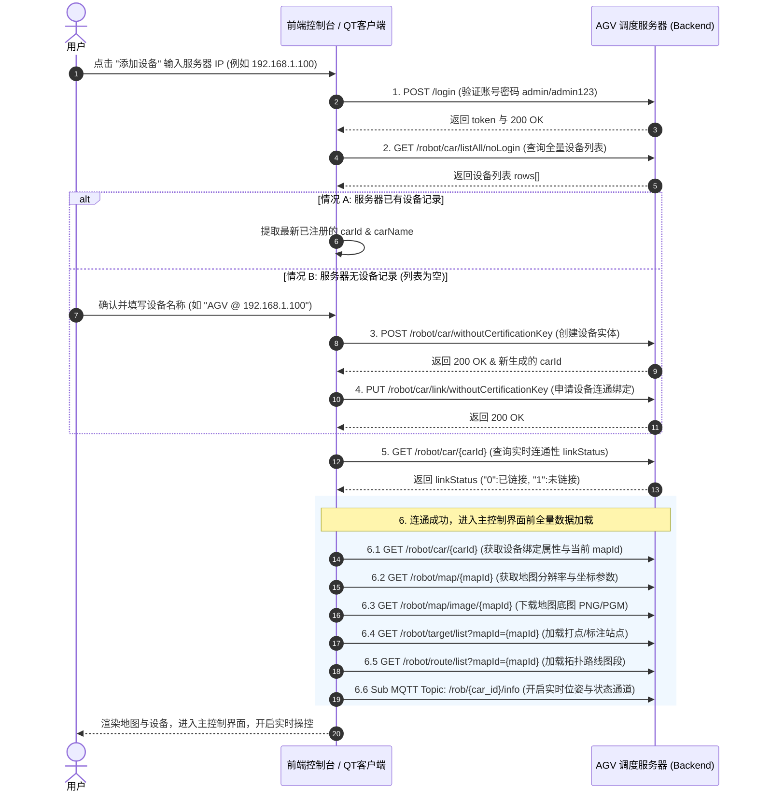

# AGV 设备管理全流程 API 规格与校验逻辑文档

本文档详细说明了在系统中从**“点击添加设备”**、**“认证与连接”**、**“新建/绑定设备”**、**“连通性状态校验”** 到 **“加载地图与控制数据”** 的完整 HTTP API 接口规格与逻辑流转过程。

---

## 1. 业务交互全视图



---

## 2. 接口规格与校验逻辑明细

### 阶段一：建立连接与身份认证

#### 1.1 系统登录认证
- **接口路径**: `POST /login` *(服务端口 8048)*
- **请求格式**: `application/json`
- **请求 Payload**:
  ```json
  {
    "username": "admin",
    "password": "..."
  }
  ```
- **核心校验逻辑**:
  1. 验证目标服务器 IP 是否可通。
  2. 校验 HTTP 响应 Code，若非 `200` 或 `token` 为空则报错提示 `"服务器无响应，请检查 IP 地址"`。
  3. 成功后将返回的 `token` 写入全局配置 `AppConfig`，后续请求在 Header 中附带 `Authorization: Bearer <token>`。

---

### 阶段二：服务器设备信息查询

#### 2.1 查询全量设备/车辆列表
- **接口路径**: `GET /robot/car/listAll/noLogin` 或 `GET /robot/car/listAll`
- **请求格式**: Query String
- **核心校验逻辑**:
  1. 检查返回 JSON 报文中的 `rows` 数组。
  2. **若 `rows` 不为空**：提取数组最后一项（或匹配项）的 `carId` 与 `carName`，跳过新建阶段直接进行阶段四的状态校验。
  3. **若 `rows` 为空**：判定该服务器尚未初始化注册 AGV 设备，弹窗提示用户输入新设备名称，触发阶段三新建逻辑。

---

### 阶段三：新建与绑定逻辑 *(服务器无设备时触发)*

#### 3.1 无需认证码创建 AGV 设备
- **接口路径**: `POST /robot/car/withoutCertificationKey`
- **请求格式**: `application/json`
- **请求 Payload**:
  ```json
  {
    "deptId": 100,
    "mapId": null,
    "carName": "AGV @ 192.168.1.100",
    "ipPort": "192.168.1.100:8061",
    "robotType": "1",
    "machinery": "0"
  }
  ```
- **核心校验逻辑**:
  1. 后端数据库创建设备记录。
  2. 校验返回 Code `200`，从 `res.data.carId` 提取新设备分配的全局唯一 ID。

#### 3.2 无需认证码申请设备连通绑定
- **接口路径**: `PUT /robot/car/link/withoutCertificationKey`
- **请求格式**: `application/json`
- **请求 Payload**:
  ```json
  {
    "carId": "2",
    "carName": "AGV @ 192.168.1.100",
    "mapId": null,
    "deptId": 100,
    "ipPort": "192.168.1.100:8061"
  }
  ```
- **核心校验逻辑**:
  1. 申请后台调度守护进程与设备 `ipPort` 建立通信握手。

---

### 阶段四：连通性与状态验证

#### 4.1 查询单台设备详细信息与连通状态
- **接口路径**: `GET /robot/car/{carId}`
- **请求格式**: Path Variable
- **核心校验逻辑**:
  1. 解析响应数据 `data.linkStatus` 字段：
     - `linkStatus == "0"`: 校验为 **已链接 (Linked/Online)**，保存设备 profile，直接完成添加。
     - `linkStatus != "0"`: 校验为 **未链接 (Unlinked/Offline)**，自动触发申请链接更新，并以未链接状态保存设备供用户手动发起连接。

---

### 阶段五：进入主控制界面前的初始化数据拉取

进入主控制面板（地图预览/设备状态/任务管理）之前，前台需顺序完成以下 6 项数据同步：

| 序号 | 接口 URI / 协议 | 方法 | 作用说明 | 关键返回字段 |
| :---: | :--- | :---: | :--- | :--- |
| **5.1** | `/robot/car/{carId}` | `GET` | 拉取设备当前绑定的地图 ID (`mapId`) 与属性（若为空则降级调 `/robot/map/list`） | `mapId`, `carName` |
| **5.2** | `/robot/map/{mapId}` | `GET` | 拉取地图元数据（像素分辨率、原点偏移） | `resolution`, `originX`, `originY` |
| **5.3** | `/robot/map/image/{mapId}` | `GET` | 下载地图底层背景图像（PNG/PGM 字节流） | Image Stream (Binary) |
| **5.4** | `/robot/target/list?mapId={mapId}` | `GET` | 拉取当前地图关联的所有站点/打点坐标 | `targetList`: `[ {x, y, theta, targetName} ]` |
| **5.5** | `/robot/route/list?mapId={mapId}` | `GET` | 拉取拓扑网络路线图段与连接关系 | `routeList`: `[ {sourceId, targetId, points} ]` |
| **5.6** | `MQTT Topic: /rob/{car_id}/info` | `SUB` | 建立高频实时状态与位姿推送通道 | `pose(x,y,theta)`, `battery`, `speed` |

---

## 3. 设备配置持久化结构

在完成上述 API 校验后，客户端将在本地配置文件（`AppConfig`）中保存该设备的上下文：

```json
{
  "ip": "192.168.1.100",
  "carId": "2",
  "name": "AGV @ 192.168.1.100",
  "token": "eyJhbGciOiJIUzUxMiJ9...",
  "linkStatus": "0",
  "lastConnected": "2026-09-10T10:50:00.000"
}
```
